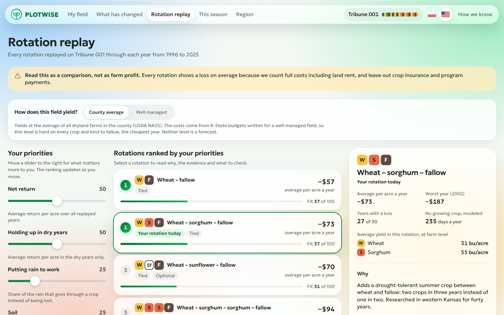
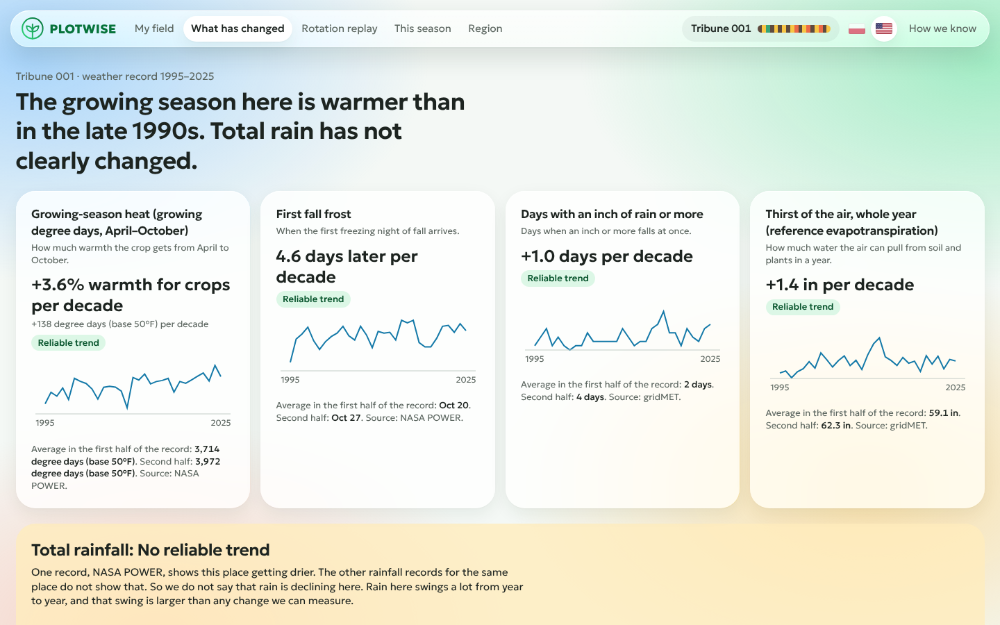
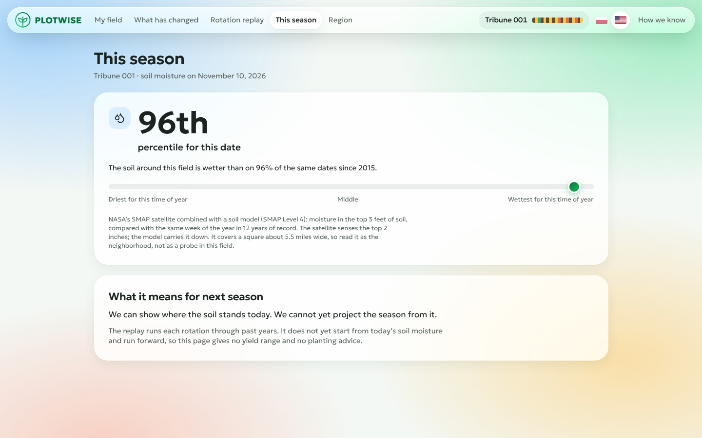
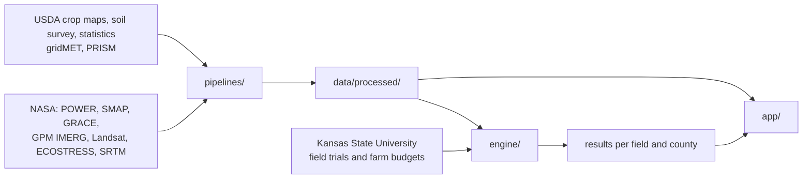
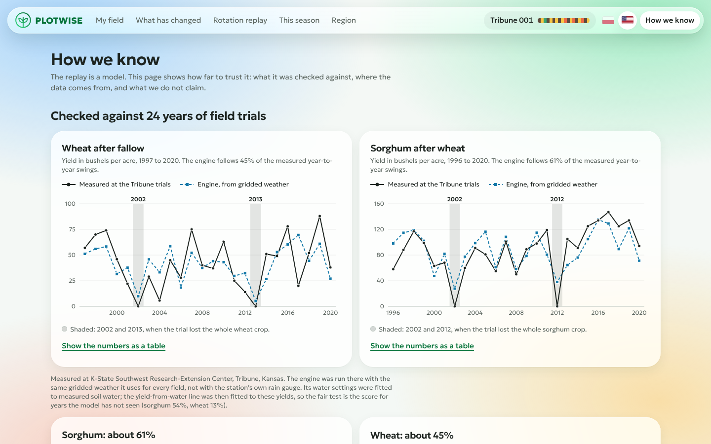
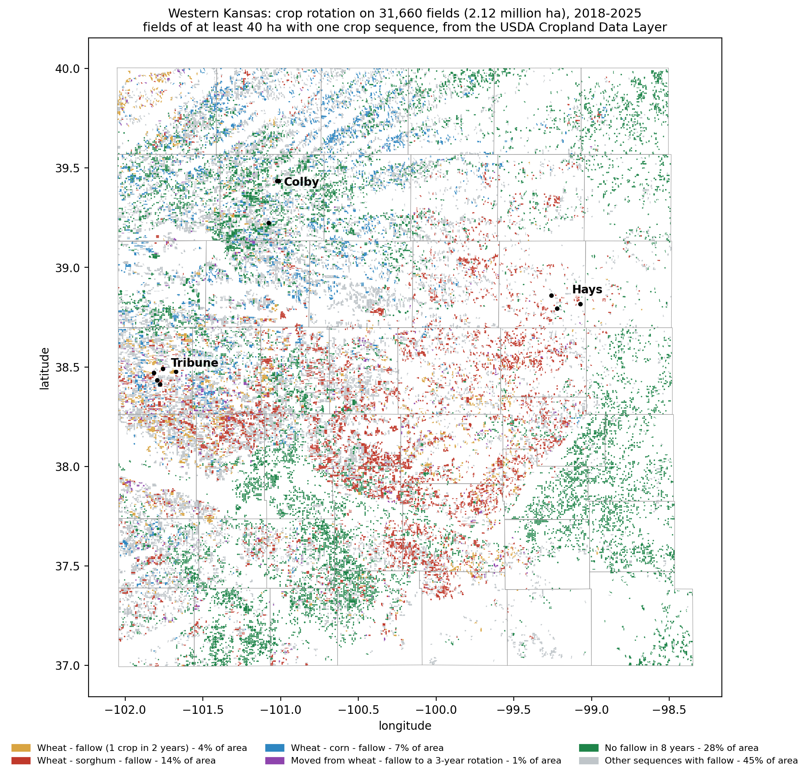

# PlotWise

**What if you had farmed this field differently for the last 30 years?**

PlotWise lets a dryland farmer replay 30 real years of weather on their own field under different crop rotations, and
see what each one would have done to yield, income, dry-year risk and soil. It ranks the rotations by the farmer's own
priorities and shows, for every suggestion, the evidence behind it, what is not known and what to check locally.

**Live app: https://kub147.github.io/PlotWise/** (English and Polish, with a phone layout)

NASA Space Apps Challenge 2026, Rzeszów ·
challenge [Field Shift: Adapting Farms with NASA Data](https://www.spaceappschallenge.org/2026/challenges/adapting-farms-with-nasa-data/)



## The problem

On the High Plains of western Kansas, rain covers only about a third of what the air can evaporate. For a century the
answer was to leave the land bare every second year so the soil could store water for the next wheat crop. Farmers are
now moving away from that: in Greeley County, fallow fell from 43% of cropland in 2008 to about 30% today.

Changing a rotation is a risk taken once and lived with for years. In the Kansas State University trials at Tribune,
wheat failed completely in 2002 and 2013, and sorghum in 2002 and 2012. The data that could inform the choice exist,
spread over a dozen NASA and USDA products at different scales. None of them answers the farmer's question:

> "My field is in wheat–fallow. Should I change the rotation, to what, and what do I risk in a dry year?"

## What the app does

A farmer picks a field and moves through six pages.

| Page | Question it answers |
| :--- | :--- |
| **My field** | What is this field: crop history since 2008 read from satellite crop maps, soil, bare-ground days, greenness, surface heat |
| **What has changed** | Which weather trends at this place are reliable, and which are not |
| **Rotation replay** | How six rotations would have done here in each year from 1996 to 2025, ranked by the farmer's priorities |
| **This season** | Where soil moisture stands today against the same dates in earlier years |
| **Region** | What farmers grow on 31,660 fields in 46 counties, and where the model agrees with them |
| **How we know** | The model against 24 years of field trials, the data sources, and what we do not claim |

| | |
| :---: | :---: |
|  |  |
| Trends carry a "reliable" label only when a trend test supports it. Rain does not get one. | Root-zone soil moisture from NASA SMAP, as a percentile for the calendar date. |

The app covers eleven real fields at three sites along the rainfall gradient (Tribune, Colby, Hays) and, more coarsely,
46 counties. Tribune is where the model is validated; the other sites show how the answer changes with rainfall.

## How it answers the challenge

| The challenge asks for | Where it is in PlotWise |
| :--- | :--- |
| Compare at least three rotation strategies, including the current one | Rotation replay: six rotations, with the field's own rotation marked "Your rotation today" |
| Rank by what the farmer values | Four sliders (net return, holding up in dry years, putting rain to work, soil); the ranking updates as they move |
| Explain why each option is suggested and what supports it | Every rotation card has "Why" and "Evidence", linked to an evidence register of published trials |
| Say what it may offer and where the gaps are | "What you gain", "What you risk" and "What we do not know" on every card |
| Say what needs local review | "Check locally" on every card |
| Show how conditions have changed | What has changed: 30-year trends, regional water storage, how the county's fields are farmed |
| Show when the field is exposed | My field: days a year with bare ground, from 18 years of Landsat greenness |

The tool supports the farmer's judgment. It does not pick a winner: when no rotation wins under most priorities, it
says the choice is a close call.

## How it works



- **Field history from space.** Field outlines and the rotation in use are derived from repeated crop sequences in the
  USDA Cropland Data Layer. The farmer does not type the rotation in; the tool reads it.
- **A soil-water engine.** A daily soil-water balance runs through every crop and every fallow. Soil water capacity
  comes from the USDA soil survey, daily weather from gridMET and NASA POWER, crop water use from FAO-56. Yield follows
  from the water each crop used, with functions published by Kansas State University.
- **Every rotation in every year.** Each phase of each rotation is started in each year, so a rotation gets the whole
  run of good and bad years instead of one lucky sequence.
- **Money as a comparison.** Yield times the Kansas price of that year, minus the Kansas State budget cost for the
  region, in 2025 dollars, scored against wheat–fallow on the same field.
- **Priorities, not a verdict.** Four scores per rotation are combined with the farmer's weights in the browser. The
  engine also tries 5,000 random sets of priorities and reports how often each rotation comes first.

There is no backend. The pipelines and the engine write small files to `data/processed/`, and the app reads them.

## Space agency data

| Dataset | What PlotWise takes from it | Page |
| :--- | :--- | :--- |
| NASA POWER | Temperature, radiation, wind; growing degree days, frost dates, hot days | What has changed |
| NASA GPM IMERG | Rainfall, as one of four records in the rainfall cross-check | What has changed |
| NASA GRACE / GRACE-FO | Regional water storage since 2002 | What has changed |
| NASA SMAP Level 4 | Root-zone soil moisture as a percentile for the date | This season |
| NASA / USGS Landsat 5, 7, 8, 9 | Greenness of each field since 2008; bare-ground days | My field |
| NASA ECOSTRESS | Land surface temperature at 70 m | My field, What has changed |
| NASA SRTM | Slope of each field | My field |
| ESA Sentinel-2 | Overview image of the demo fields | Documentation |

Each dataset has one defined job. Together with USDA crop maps (Cropland Data Layer), the soil survey (SSURGO), USDA
statistics, gridMET and PRISM they are combined at field scale. The full list with access paths and references is in
[`docs/submission/data-and-references.md`](docs/submission/data-and-references.md); datasets we evaluated and did not
use are in [`docs/data-sources.md`](docs/data-sources.md).

## How far to trust it



The engine was checked against yields measured year by year at the Kansas State University Southwest
Research-Extension Center in Tribune, 1996–2020 ([`docs/engine-validation.md`](docs/engine-validation.md)).

- **Sorghum:** modelled water use explains about 61% of the year-to-year variation in measured yield, and 54% for
  years left out of the fit.
- **Wheat:** about 45%, and only about 13% for years left out of the fit. The app says a single wheat year is a rough
  estimate.
- The model's two lowest years for each crop are the measured crop-failure years.
- For 2008–2015, at well-managed yields, the replay puts wheat–sorghum–fallow first, wheat–fallow second and wheat–corn–fallow last, the same
  order as the Kansas State large-scale study.

We also cross-check inputs. Four rainfall records were compared at every field: gridMET stays within 8% of
station-based PRISM, while one record (NASA POWER) shows a drying trend at Tribune that the other three do not. We
therefore use POWER for temperature and radiation and do not claim that rain is declining.

## What we found

- **The answer depends on where you farm.** The gain from replacing fallow with sorghum rises from about −17 USD per
  acre a year in the driest counties to about +12 in the wettest
  ([`docs/engine-counties.md`](docs/engine-counties.md), [`docs/transect.md`](docs/transect.md)).
- **It is warmer, and the air is thirstier; rain has not clearly changed.** At Tribune the growing season gains about
  138 °F·days per decade and the first fall frost comes later.
- **The region is losing stored water.** GRACE shows about 7 inches of water lost since 2002.
- **Bare fallow runs hot.** On the same summer afternoons, fallow around Tribune was 8 to 10 °F hotter at the surface
  than sorghum (ECOSTRESS, three scenes).



## Limits

- The replay compares rotations; it is not a profit forecast. Costs include land rent and leave out crop insurance and
  government payments, so most averages are below zero.
- Gridded weather describes the area around a field (2.5 to 30 miles), not the field itself. Fields at one site get
  almost the same weather; what differs is their soil and history.
- Wheat is modelled weakly: winterkill, disease, hail and late freezes are not water effects.
- Corn and sunflower have no local trial series and are the least certain.
- County results stand on one point per county. Where the model and local practice disagree, the app says so.
- "This season" shows where the soil stands today. It makes no forecast.

## Run it

The app (Node.js 24):

```bash
cd app
npm install
npm run dev      # copies the data into app/static, then serves http://localhost:5173
npm run build    # production build in app/build
```

A push to `main` builds the app and publishes it to GitHub Pages (`.github/workflows/deploy-app.yml`).

The data and the engine (Python 3; Earth Engine steps need your own project in `EE_PROJECT`):

```bash
# climate indicators and trends for any point (no key needed)
python3 scripts/power_indicators.py --lat 38.47 --lon -101.75 --out climate.json

# daily weather and climate summary for every demo field
EE_PROJECT=<your-ee-project> python3 pipelines/weather/run.py all

# replay the rotations and validate against the Tribune trials
python3 -m engine.run
python3 -m engine.validate
```

## Repository layout

```
app/              the web app (React, TypeScript, Vite)
pipelines/        data extraction per source (weather, fields)
engine/           soil-water balance, yields, economics, scoring, validation
crops-economics/  crop table, rotations, prices, costs and the evidence register
data/             processed/ is committed, raw/ is not
reference/        published tables transcribed with citations (K-State trials)
scripts/          exploratory scripts that reproduce the numbers in the docs
docs/             data and research notes, validation reports, submission material
```

Where to read more: [`docs/why-western-kansas.md`](docs/why-western-kansas.md) (why the demo is set at Tribune),
[`docs/research-evidence.md`](docs/research-evidence.md) (what the field trials say),
[`docs/engine-validation.md`](docs/engine-validation.md) (the engine against measured yields).

## Use of AI

We used AI tools as assistants, and this is where.

- **Code and documents.** Team members used Claude (Anthropic), in Claude Code and in chat, as an assistant for
  writing and revising code and documents: the web app in `app/`, the data pipelines, the engine and the notes in
  `docs/`. Each of the five workstreams worked from its own written brief; a team member directed each step, ran
  the code and reviewed the result.
- **How the AI-written code was checked.** Against data it could not have seen: the engine against 24 years of
  measured trial yields, the weather pipeline against four independent rainfall records, county results against USDA
  county yields. Where a check failed, the app and the documentation say so (for example NASA POWER rainfall above,
  or OpenET running about 20% above rainfall in [`pipelines/weather/README.md`](pipelines/weather/README.md)).
- **No number comes from an AI model.** Every figure in the app is computed by the scripts in this repository from
  the public datasets listed above. The trend tests and the soil-water model are ordinary statistics and process
  modelling, not machine learning.
- **Images.** The app contains no AI-generated photos, video or audio. Maps, satellite images and charts are drawn
  from data. The PlotWise logo is an SVG drawn with an AI assistant.
- No NASA logos or mission marks are used.

## Team

Five Geospatial Computer Science students from AGH University of Krakow.

| Workstream | Who |
| :--- | :--- |
| Weather and water | Oliwia Grądzka |
| Fields, soil and vegetation | Jakub Wilk |
| Crops, rotations and economics | Natalia Kadłuczka |
| Engine and validation | Jakub Naporowski |
| App and story | Miłosz Wiktorowicz |

## License

Code: [MIT](LICENSE). The data in `data/processed/` and `reference/` is derived from public sources (NASA, USDA,
K-State Research and Extension, gridMET, OpenET) that keep their own terms; cite the original source, listed in
[`docs/submission/data-and-references.md`](docs/submission/data-and-references.md).
