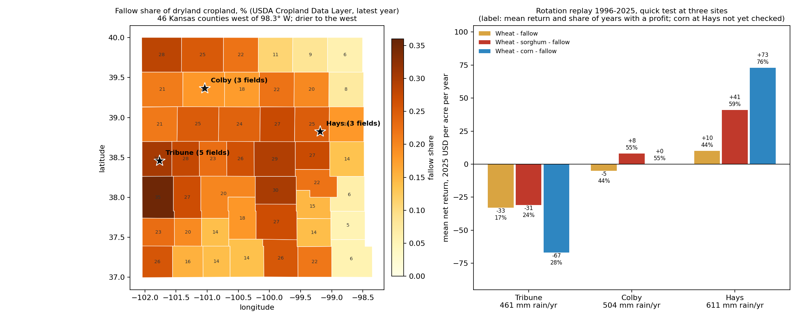
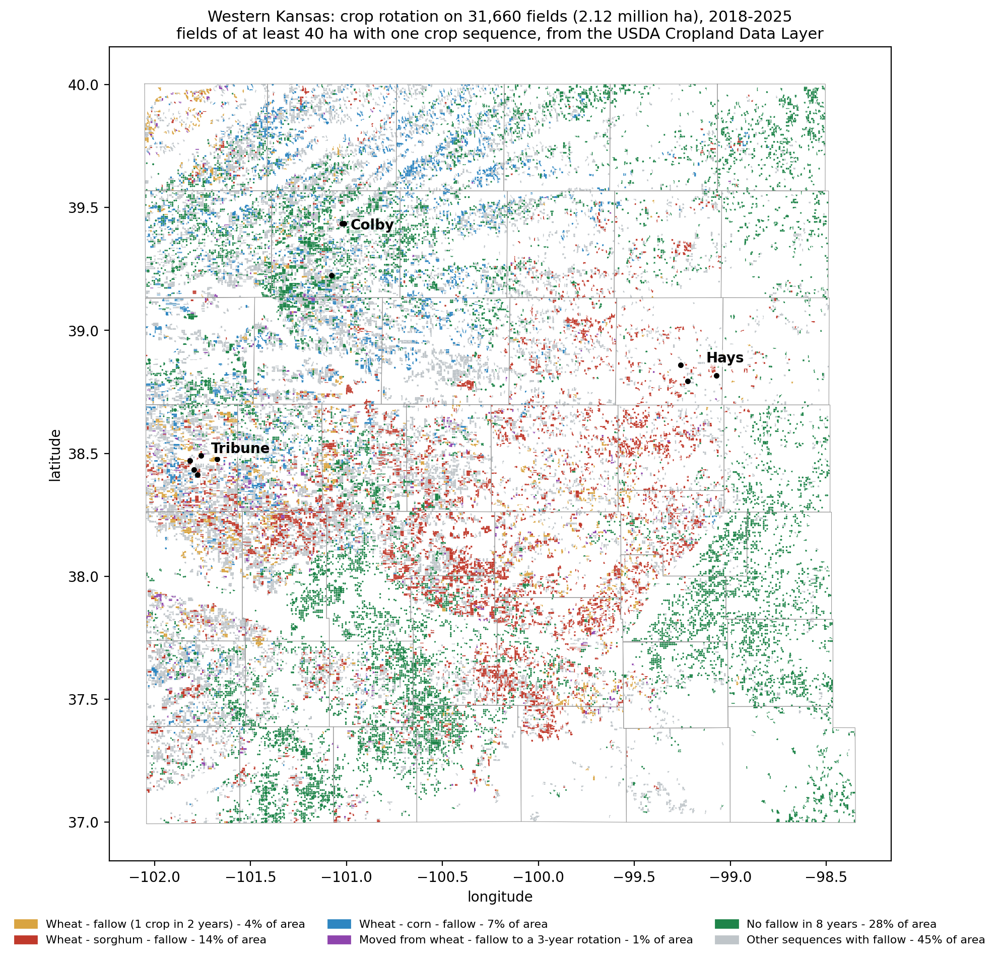

# Western Kansas transect — why and what each workstream does next

Decided on 2026-11-14 after the first full engine run. Tribune stays the validation site; the demo widens to three
sites along the rainfall gradient and to a county map of western Kansas.

## Why

At Tribune every rotation loses money on average and the five fields get almost the same numbers. That is a true
picture of the driest end of the region, but a demo with one site cannot show what the tool is for. A quick test of
the engine at K-State station towns (gridMET weather at the town, SSURGO soil at the point, south-west Kansas costs
everywhere, 1996–2025) shows that the answer changes over 250 km:

| Site | Rain mm/yr | Wheat–fallow | Wheat–sorghum–fallow | Wheat–corn–fallow | Reading |
| :--- | ---: | ---: | ---: | ---: | :--- |
| Akron, Colorado | 422 | −18 (31%) | −30 (28%) | −79 (31%) | fallow is the least bad |
| **Tribune** | 461 | −33 (17%) | −31 (24%) | −67 (28%) | nothing pays; fallow is survival |
| Garden City | 483 | −40 (28%) | −33 (24%) | −54 (34%) | same |
| **Colby** | 504 | −5 (44%) | **+8 (55%)** | 0 (55%) | replacing fallow turns a loss into a small profit |
| **Hays** | 611 | +10 (44%) | +41 (59%) | +73 (76%) | every rotation pays; intensifying pays more |
| Great Bend | 676 | +11 (48%) | +45 (62%) | +86 (76%) | same |

Mean net return in 2025 USD per acre per year; in brackets the share of years with a profit. This was a test, not a
result: see the cautions below. Further east (Belleville, Hutchinson) fallow is hardly used, so the question
disappears; the transect stops near 98.3° W.

## Cautions

- **The engine is calibrated at Tribune only.** Confidence drops with distance. Colby (140 km) is safer than Hays (230 km).
- **Corn is the weakest part.** It has no calibration of its own, and the modelled 122 bu/acre for dryland corn at Hays looks high.
  The crop history agrees with the doubt: around Hays 103 of 252 clean fields are in wheat–sorghum–fallow and almost none grow corn,
  while the model ranks wheat–corn–fallow first. Check against county corn yields before showing the Hays corn number.
- **Costs differ by region.** The test used south-west Kansas budgets everywhere; K-State publishes separate north-west and
  north-central budgets.
- **Bare-soil days use one NDVI threshold (0.25) everywhere.** In wetter Ellis County fallow fields are greener (weeds), so their
  bare-day counts are low and not comparable with Tribune.

- **County soil comes from a 2 km square at the county centroid.** In nine counties (Barber, Barton, Clark, Comanche, Ellis, Ford, Russell, Seward,
  Stafford) that square gives under 200 mm, well below the cropland fields nearby (Ellis: 151–193 mm at the centroid, 279–297 mm on the three demo fields).
  For the county map use at least 280 mm (the median) where `awc_mm` is below 200, or ask B for a cropland-weighted value.

Checks on the county layer: fallow share falls from west to east (24% of dryland cropland west of 101° W, 9% east of 99° W; correlation with
longitude −0.56) and fell in 39 of 46 counties between 2008 and the latest CDL year (mean 26% → 20%).

## What exists now (workstream B)

- `data/processed/fields.geojson`: **11 fields at three sites** (new property `site`): Tribune `ks071-001…005`, Colby `ks193-001…003`,
  Hays `ks051-001…003`, with crop history, soil, slope and NDVI as before.
- `data/processed/counties.geojson`: **46 Kansas counties west of 98.3° W** with `county_id` (e.g. `ks071`), centroid `lon`/`lat`,
  `awc_mm` from SSURGO near the centroid, and CDL statistics for 2008 and the latest year (`fallow_share_*`, `summer_to_wheat_*`,
  crop hectares). County centroids are not fields; treat county results as indicative.

## Field map of the whole transect

`pipelines/fields/delineate_all.py` and `transect_rotations.py` read the 2018–2025 crop sequence of every clean field of at least 40 ha in the 46 counties:
**31,660 fields, 2.12 million ha.**

| Longitude band | Counties | Fields | Wheat–fallow | Wheat–sorghum–fallow | Wheat–corn–fallow | No fallow in 8 years |
| :--- | ---: | ---: | ---: | ---: | ---: | ---: |
| 102°–101° W | 14 | 13,458 | 5.0% | 7.5% | 9.9% | 22.4% |
| 101°–100° W | 10 | 8,376 | 1.9% | 16.1% | 7.9% | 29.3% |
| 100°–99° W | 15 | 7,417 | 4.8% | 29.3% | 2.3% | 23.0% |
| 99°–98.3° W | 7 | 2,409 | 0.4% | 2.0% | 0.5% | 81.9% |

Shares of field area; the rest are other sequences with fallow (45% overall), i.e. fields that do not follow a fixed rotation.

What the map shows:
- **East of 99° W fallow is gone** (82% of field area had no fallow in eight years). That is where the transect should stop.
- **Wheat–sorghum–fallow is the rotation of the centre and south; wheat–corn–fallow of the north-west.** Farmers choose corn where it is cooler and sorghum where it is hotter.
  The engine should reproduce this split; if it ranks corn first around Hays, where almost nobody grows it, the corn model is the first suspect.
- **Strict wheat–fallow is rare everywhere (4%)** and concentrated along the Colorado border.
- **"No fallow" in the west is mostly irrigation** (the round fields in the south-west and north-west); in the east it is dryland continuous cropping. Do not read the two as the same thing.

Per-county numbers are in `data/processed/county_field_rotations.json` (`rotations`, `fallow_based_share`, `three_year_share`); polygons for the three demo counties
(Greeley, Thomas, Ellis; 3,042 fields) are in `data/processed/county_fields.geojson` with a `county_id`. Polygons for all 46 counties are not committed (too heavy for the app);
they can be rebuilt with the two scripts.

## Next steps per workstream

| | Task |
| :--- | :--- |
| **A** | Run the weather pipeline for the six new fields. For the county map: a weather CSV per `county_id` at the centroid in `counties.geojson` (same format, e.g. `data/processed/weather/counties/ks071.csv`); climate JSON is not needed for counties |
| **C** | Add north-west and north-central Kansas dryland budgets to `costs.csv` with a region key; tell D which counties use which. County yields for all 46 counties for validation |
| **D** | Compare, per county, the rotation the engine ranks first with what farmers practise (`county_field_rotations.json`). Replay the new fields; replay each county (`awc_mm` and weather from the county layer) and write one small file with best rotation, mean return per rotation and share of profitable years per county; compare modelled and NASS yields per county, corn first |
| **E** | Site switch (Tribune / Colby / Hays) in the field view; county map coloured by best rotation or by the gain from replacing fallow; the story "the answer depends on where you farm" |
| **B** | Done for now. On request: more fields per site, NDVI charts and previews for the new fields |
